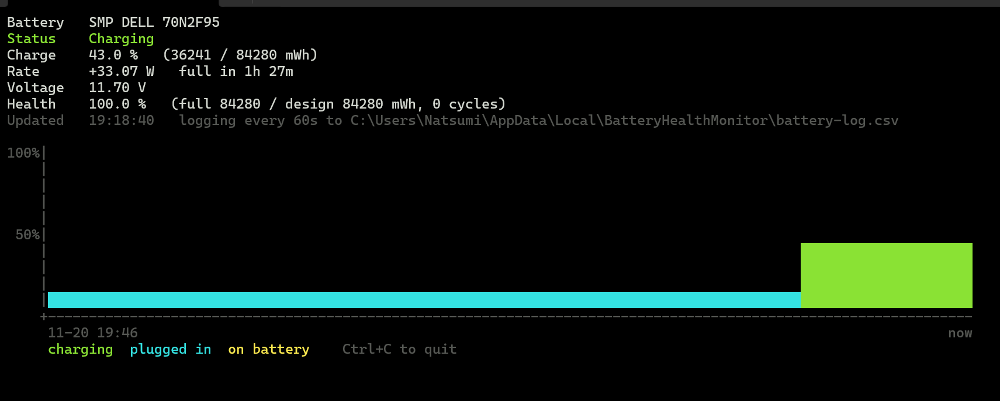
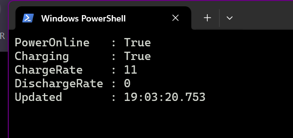

# BatteryHealthMonitor

Small util that updates the charger status live.
I built this because my charging brick's ID wire broke, so it would sometimes send the correct 240W and sometimes default to low power.
Ouch!

There are two versions: a powershell script and a C# console app.

## C# version



Same thing but fancier. Logs to `%LOCALAPPDATA%\BatteryHealthMonitor\battery-log.csv` so the graph is still there after a restart.

### Building

```powershell
dotnet build -c Release
```

Output .exe will be `bin\Release\net48\BatteryMonitor.exe`.

## battery.ps1



The original powershell script.
You can get the same information from the following ps command:

```powershell
Get-CimInstance -Namespace root\wmi -ClassName BatteryStatus | Select PowerOnline, Charging, ChargeRate, DischargeRate
```
